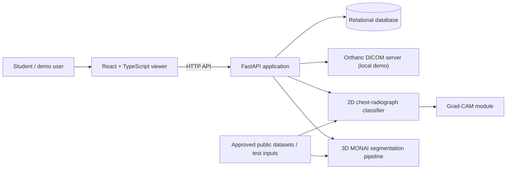

# Proposed Architecture and Data Flow

> **For educational purposes only, not for clinical use.**

## 1. Status

This is a proposed architecture for the educational internship project. It describes intended boundaries and data flow, not completed implementation. Technology and deployment choices remain subject to feasibility checks.

## 2. System context

The user interacts with a browser-based viewer. The planned application uses an API for validation, model inference, DICOM access, and review records. Orthanc is intended for a local DICOM demonstration. The selected public educational datasets support model development and evaluation.

## 3. Container and responsibility view

| Component | Planned responsibility | Important boundary |
|---|---|---|
| React/TypeScript frontend | Upload flow, status, image/study viewing, prediction display, overlays, human review, audit history, limitations and disclaimer. | It presents API outputs; it does not implement model training or make clinical conclusions. |
| FastAPI backend | Validate requests, coordinate supported inference, mediate Orthanc access, store review/audit events, return structured errors and health status. | API routes should call service modules rather than contain model-training logic. |
| Classification package | Prepare 2D chest radiographs, train/evaluate a selected model, perform inference, return mapped scores. | Classification is only for documented supported inputs and labels. |
| Explainability package | Generate Grad-CAM for supported classifier/model layers and provide overlay-ready output. | A heatmap is an attribution visualization, not proof of correctness or a diagnosis. |
| Segmentation package | Load a selected MSD 3D task, apply spatial transforms, train/evaluate/infer with MONAI. | It is a separate 3D workflow from chest-X-ray classification. |
| Orthanc | Store/manage local demonstration DICOM studies and expose resource retrieval. | Do not expose the local server publicly without a separate security design. |
| Database | Persist human review actions and relevant audit events. | Store only data needed for the project; avoid image payloads and unnecessary patient identifiers. |
| Dataset/artifact storage | Keep approved datasets, checkpoints, and generated outputs outside normal source-code history. | Use local paths or configured data/artifact storage; do not commit large or sensitive files. |

## 4. Data-flow paths

### 4.1 Classification path

1. A user submits a supported chest-radiograph image or a supported image retrieved through the DICOM workflow.
2. The API checks file size, type, readability, and permitted input characteristics.
3. The classification preprocessing pipeline performs the documented grayscale, resize, intensity normalization, and other required steps.
4. The classifier runs inference using an explicitly identified model artifact and class-label mapping.
5. The API validates that output values are finite and have the expected shape.
6. Grad-CAM runs only for model/input combinations documented as supported.
7. The API returns structured model outputs and visualization references to the browser.
8. The UI labels outputs as model-generated educational predictions and displays the required disclaimer.
9. If a reviewer approves or rejects the displayed result, the API records the action in the persistent audit store.

### 4.2 Segmentation path

1. A supported 3D volume is selected from an approved dataset or supported local DICOM workflow.
2. The loader reads image and spatial metadata, including dimensions, orientation, and spacing where available.
3. Image and mask transforms are applied together so their spatial relationship is maintained.
4. The segmentation model produces a mask or probability volume for its selected, documented task.
5. Output geometry and spatial metadata are checked before visualization or export.
6. The viewer displays only results that passed validation and labels them as model-generated.
7. Any review action is recorded separately from the segmentation output.

### 4.3 DICOM path

1. A DICOM file is uploaded to or already managed by the local Orthanc instance.
2. The backend validates the file and uses Orthanc’s REST API to retrieve supported study, series, instance, or image content.
3. Metadata needed for navigation is returned with unnecessary identifiers omitted or masked in the UI.
4. Pixel data is sent through the appropriate modality-specific preprocessing path.
5. DICOM metadata remains distinct from classifier predictions, segmentation output, and human decisions.

Orthanc provides a REST API for managing DICOM resources; integration behavior will be verified against the actual local server and test files before being considered supported.

## 5. Trust and privacy boundaries

- Treat all uploaded images and DICOM metadata as sensitive, even when the demo uses public data.
- Do not use real patient data in a public hosted demo.
- Validate upload size, extension, content, and parseability; extensions alone are not proof of file type.
- Use generated identifiers or minimal internal references in application logs and audit records.
- Keep secrets in local environment variables or deployment secrets, never in tracked files.
- Keep Orthanc local during development unless an explicit deployment security plan is approved.
- Do not return filesystem paths, stack traces, credentials, or unnecessary DICOM identifiers to the browser.
- Revisit the privacy and threat model before any public deployment.

## 6. Error-handling principles

- Unsupported formats return a clear client-facing error without attempting model inference.
- Corrupt or malformed inputs fail safely and do not crash the service.
- Missing or incompatible model artifacts produce a controlled “model unavailable” response.
- Non-finite predictions, unexpected tensor shapes, or failed spatial alignment are rejected rather than displayed as valid results.
- Orthanc or database outages are reported as service errors; the system does not silently claim the operation succeeded.
- Review actions are recorded only after the requested operation is accepted and persisted.

## 7. Provisional deployment topology

The intended hosted-demo split is:

- Frontend: Vercel, if the final Vite configuration and API integration are compatible.
- Backend: Render, if service resources, runtime, and costs/limits are suitable.
- Database: an appropriate persistent database service; do not rely on an ephemeral local filesystem for audit persistence.
- Orthanc: local-only demonstration unless a secure and feasible hosted plan is confirmed.
- Large datasets and model artifacts: kept outside the web service image and source repository; exact storage method to be decided.

This topology is provisional. Deployment is not considered complete until a real deployment and end-to-end smoke test succeed. No real patient data will be used in the hosted demo.

## 8. Open decisions

The following decisions remain unresolved until feasibility is confirmed:

- Final classification dataset and its access terms.
- Final classifier architecture and supported label set.
- Final MSD task and whether training will be full or a bounded pilot.
- Local versus Colab training split and checkpoint-transfer workflow.
- Database provider and schema details.
- Exact DICOM formats and transfer syntaxes supported.
- Artifact storage approach.
- Hosted service plan and deployment availability.

## 9. Architecture acceptance checks

This document is accepted for the planning phase when:

- Classification and segmentation are clearly separate workflows.
- Data flow includes validation, preprocessing, inference, visualization, human review, and persistent audit.
- DICOM metadata is distinguished from model-generated findings.
- Privacy, error handling, and local Orthanc boundaries are documented.
- Open decisions are explicitly marked provisional.